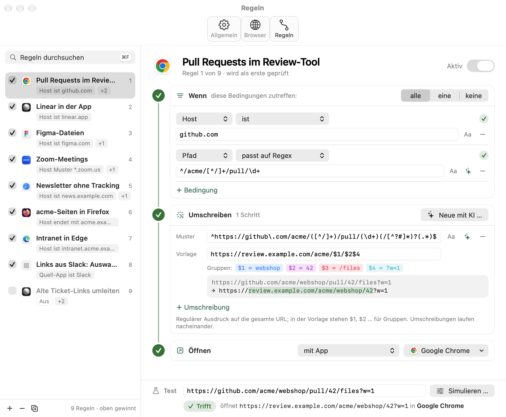
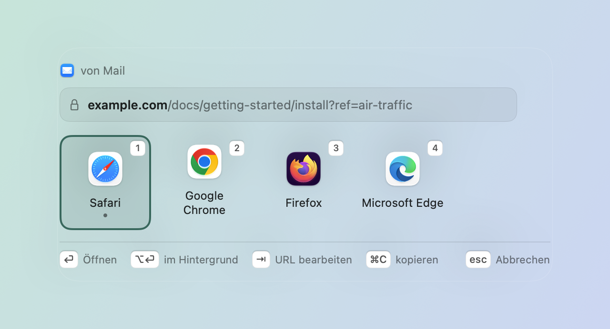
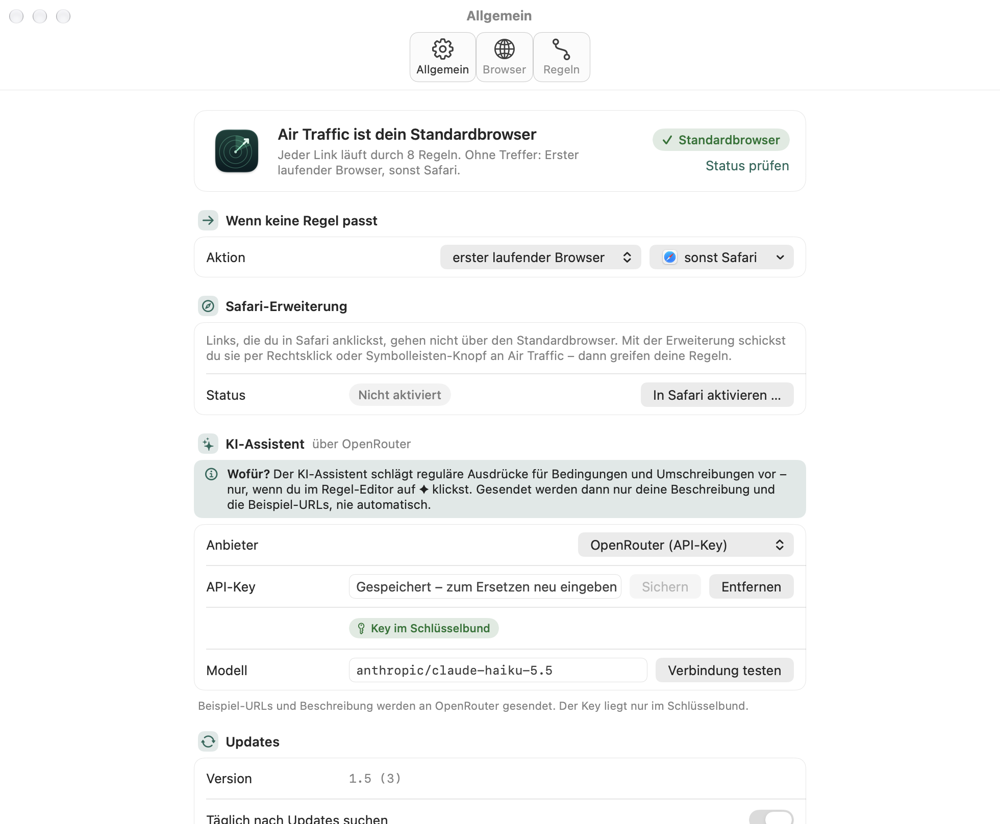
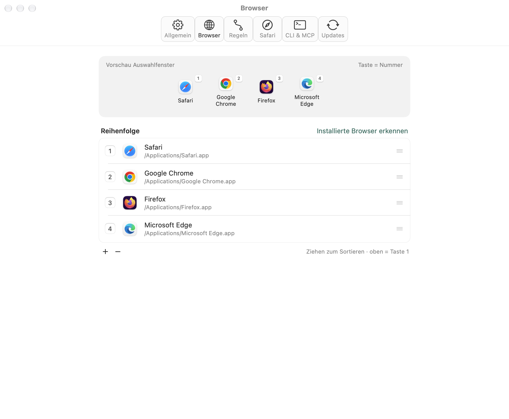
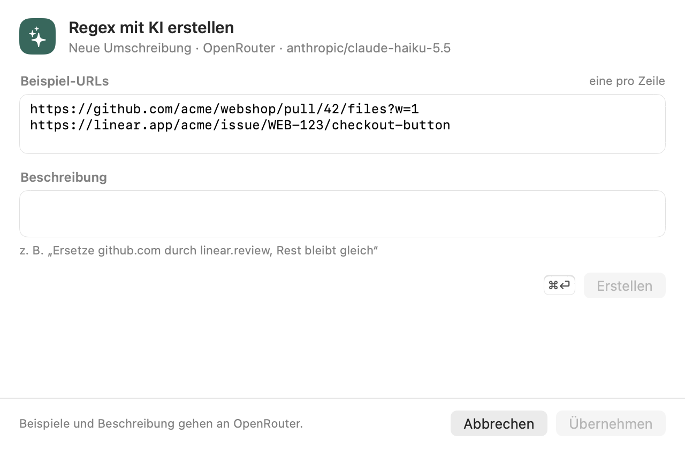

# Air Traffic

Air Traffic ist ein „Browser-Verteiler“ für macOS. Die App wird als Standardbrowser eingetragen,
nimmt jeden angeklickten Link entgegen, prüft ihn gegen deine Regeln, schreibt ihn bei Bedarf um
und öffnet ihn im passenden Browser oder in der passenden App. Passt keine Regel, entscheidet die
Standardaktion – zum Beispiel ein kleines Auswahlfenster mit allen Browsern.



## Funktionen

- **Regeln:** Bedingungen auf URL, Host, Pfad, Quell-App, gedrückte Tasten und Linktyp
  (ist, enthält, beginnt mit, endet mit, Muster, regulärer Ausdruck …). Die erste passende Regel gewinnt.
- **Umschreiben:** Regex-Umschreibungen vor dem Öffnen, etwa GitHub-Pull-Requests in ein Review-Tool
  umleiten oder Tracking-Parameter entfernen. Mehrere Schritte laufen nacheinander.
- **Test je Regel:** Test-URL im Regel-Editor zeigt live, welche Bedingung trifft, jeden
  Umschreibschritt, die Ergebnis-URL und ob eine frühere Regel zuerst greift.
- **Auswahlfenster:** Browser per Zifferntaste wählen, URL vor dem Öffnen bearbeiten, `⌥⏎` öffnet im Hintergrund.
- **KI-Assistent:** beschreibe eine Umschreibung oder Bedingung in Worten, die App erzeugt den
  regulären Ausdruck und prüft ihn lokal an deinen Beispiel-URLs. Drei Anbieter:
  - OpenRouter (eigener API-Key),
  - Claude-Abo über die installierte Claude-Code-CLI,
  - ChatGPT-Abo über die installierte Codex-CLI.
- **Safari-Erweiterung:** schickt Links aus Safari per Rechtsklick oder Symbolleisten-Knopf an Air Traffic.
- **Choosy-Import:** übernimmt Regeln und Browserliste aus Choosy.
- **Updates:** prüft täglich auf neue Versionen (Sparkle) und installiert sie automatisch –
  sobald weder Auswahlfenster noch Einstellungen offen sind.

| Auswahlfenster | Allgemein |
|---|---|
|  |  |

| Browser | KI-Assistent |
|---|---|
|  |  |

Alle Screenshots stammen aus der neutralen Beispiel-Konfiguration [`docs/demo-config.json`](docs/demo-config.json).

## Installation

1. Das neueste `Air-Traffic-<version>.zip` unter
   [Releases](https://github.com/neobarthold/air-traffic/releases) laden und entpacken.
2. `Air Traffic.app` nach `/Programme` ziehen.
3. Starten. Die App ist mit Developer ID signiert und von Apple notarisiert; Gatekeeper lässt sie
   ohne Umweg zu. (Version 1.4 war nur ad hoc signiert – dort einmalig Rechtsklick → Öffnen.)
4. In den Einstellungen unter **Allgemein** auf „Als Standardbrowser festlegen“ klicken und bestätigen.

Voraussetzung: macOS 15 oder neuer.

## Safari-Erweiterung

Links, die du in Safari anklickst, öffnet Safari selbst – sie gehen nicht über den Standardbrowser,
deine Regeln greifen also nicht. Die mitgelieferte Erweiterung schickt solche Links gezielt an Air Traffic.

**Aktivieren:** Air Traffic → Einstellungen → **Allgemein** → Abschnitt „Safari-Erweiterung“ →
„In Safari aktivieren …“, dort „Air Traffic“ einschalten. Alternativ direkt in Safari → Einstellungen →
Erweiterungen. Der Abschnitt in Air Traffic zeigt, ob die Erweiterung aktiv ist.

**Bedienung:**

- Rechtsklick auf einen Link → **Mit Air Traffic öffnen**: läuft durch deine Regeln wie jeder andere Link.
  Als Quell-App gilt Safari (`com.apple.Safari`).
- Rechtsklick auf einen Link → **Mit Air Traffic auswählen …**: Umschreibungen der passenden Regel
  werden angewendet, dann erscheint immer das Auswahlfenster mit allen Browsern.
- **Symbolleisten-Knopf** (Air-Traffic-Symbol): öffnet die aktuelle Seite mit Air Traffic.

Die Erweiterung braucht keinen Zugriff auf Webseiten: Sie liest nur den angeklickten Link bzw. die
URL des aktiven Tabs und übergibt sie über das URL-Schema
`airtraffic://open?url=<prozentkodiert>[&source=<bundleID>][&prompt=1]` an die App.

## Bauen aus dem Quellcode

Benötigt Xcode 27 und [XcodeGen](https://github.com/yonaskolb/XcodeGen) (`brew install xcodegen`).

```sh
xcodegen generate
xcodebuild -project AirTraffic.xcodeproj -scheme AirTraffic -configuration Debug \
  -derivedDataPath build build
open "build/Build/Products/Debug/Air Traffic.app"
```

Das Xcode-Projekt wird aus `project.yml` erzeugt und nicht eingecheckt. Sparkle kommt als
Swift-Package (Version 2.10.1) und wird beim ersten Build geladen.

Aufbau:

- `App/` – AppKit-App mit SwiftUI-Ansichten (Auswahlfenster, Einstellungen, Updates).
- `SafariExtension/` – Safari-Web-Extension (Manifest V3, `background.js`) und
  `SafariWebExtensionHandler`; wird als `Contents/PlugIns/SafariExtension.appex` eingebettet.
- `Packages/AirTrafficCore/` – Regeln, Umschreiben, Konfiguration, Choosy-Import, KI-Assistent;
  nur Foundation, vollständig getestet.
- `docs/SPEC.md` – Spezifikation.

**Safari-Erweiterung beim Entwickeln:** Debug-Builds sind nur ad hoc signiert. Safari lädt die
Erweiterung dann erst nach Safari → Einstellungen → Erweitert → „Funktionen für Webentwickler einblenden“
und Entwickler → „Nicht signierte Erweiterungen erlauben“ (gilt bis zum Beenden von Safari).
Ist zusätzlich eine installierte Air Traffic in `/Programme` vorhanden, entscheidet macOS, welche Kopie
`airtraffic://` öffnet – zum Testen nur eine Kopie registriert lassen.

## Tests

```sh
swift test --package-path Packages/AirTrafficCore
```

Die Tests laufen ohne Netzwerk und ohne echte KI-Aufrufe (Fake-Clients und Fake-Prozesse).

## Debug-Schalter

Alle Schalter starten ohne Fenster und beenden sich danach. `AIRTRAFFIC_CONFIG_PATH=<datei>` lenkt
auf eine andere Konfiguration um.

```sh
APP="build/Build/Products/Debug/Air Traffic.app/Contents/MacOS/Air Traffic"

# Entscheidung für eine URL als JSON (welche Regel, Ergebnis-URL, Aktion)
"$APP" --decide "https://github.com/acme/webshop/pull/42" [--source com.tinyspeck.slackmacgap]
# … auch für airtraffic://-Links, wie sie die Safari-Erweiterung schickt (öffnet nichts)
"$APP" --decide "airtraffic://open?url=https%3A%2F%2Fgithub.com%2Facme%2Fwebshop%2Fpull%2F42&source=com.apple.Safari&prompt=1"

# KI-Vorschlag als JSON (Anbieter sonst aus der Konfiguration)
"$APP" --suggest-regex "Ersetze github.com durch review.example.com" \
  --example "https://github.com/acme/webshop/pull/42" [--mode rewrite|condition] \
  [--provider openrouter|claude|codex]

# PNGs aller Ansichten in hell und dunkel
"$APP" --snapshot /tmp/air-traffic-snapshots
```

Die README-Screenshots erzeugt `scripts/screenshots.sh` (baut die App und rendert mit
`docs/demo-config.json` nach `docs/images/`).

## Release

```sh
scripts/release.sh 1.4 --notes "- Neu: …"      # oder Abschnitt „## 1.4“ in CHANGELOG.md
scripts/release.sh 1.4 --dry-run               # nur bauen und signieren
scripts/release.sh 1.4 --dry-run --no-sign     # nur bauen
```

Das Skript setzt `MARKETING_VERSION` und `CURRENT_PROJECT_VERSION` (Build + 1) in `project.yml`, baut
die Release-Version, signiert sie mit Developer ID (Safari-Erweiterung zuerst, mit ihren Sandbox-Entitlements)
und lässt sie notarisieren, packt `build/dist/Air-Traffic-<version>.zip`, signiert es mit Sparkles
`sign_update` (EdDSA-Schlüssel im Schlüsselbund, Account `air-traffic`; die Werkzeuge lädt es bei Bedarf
nach `build/sparkle-tools`), ergänzt `appcast.xml` und legt das GitHub-Release `v<version>` mit dem ZIP
an. Commit und Push macht es nicht – es druckt die Befehle dafür. Erst mit dem Push von `appcast.xml`
sehen installierte Apps das Update.

## Datenschutz

- Air Traffic sendet Links nirgendwohin: Regeln, Umschreibungen und Tests laufen lokal.
- Die Safari-Erweiterung hat keine Website-Berechtigungen und kein Content-Script; sie sieht nur den
  Link, den du per Rechtsklick oder Symbolleisten-Knopf an Air Traffic schickst.
- Der KI-Assistent arbeitet **nur auf Klick** (✦ im Regel-Editor). Gesendet werden dann nur deine
  Beschreibung und die Beispiel-URLs – an OpenRouter bzw. über die lokale CLI an Anthropic oder OpenAI.
- Der OpenRouter-API-Key liegt nur im macOS-Schlüsselbund, nie in der Konfigurationsdatei oder im Log.
  Claude Code und Codex nutzen ihre eigene Anmeldung; Air Traffic sieht keine Zugangsdaten.
- Die Update-Prüfung lädt nur `appcast.xml` von GitHub; Updates werden über ihre EdDSA-Signatur geprüft.

Konfiguration: `~/Library/Application Support/Air Traffic/config.json`.

## Lizenz

© neoskop. Alle Rechte vorbehalten.
